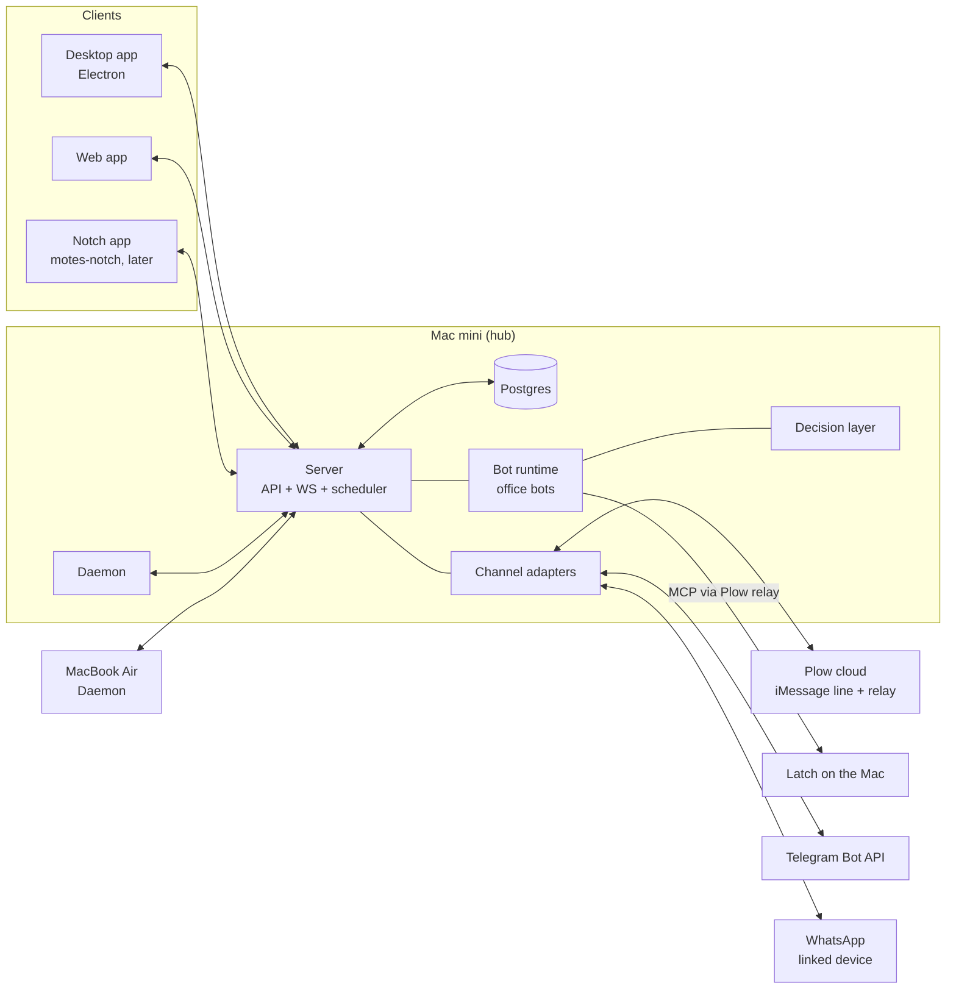

# Motes: design

> Version 1 · 2026-10-29 · owner: Jean Jacintho
> Source of truth for what Motes is and how it is built. [ROADMAP.md](ROADMAP.md) turns it into cards.
> Decisions marked **(builder's call)** were made while writing this document and were not explicitly decided by the owner. Everything else was decided by the owner.

## 1. In one paragraph

Motes is a personal, self-hosted workspace where a team of AI bots works on the owner's projects with as little babysitting as possible. Work flows through a **board pipeline** (cards are picked up by bots, executed, and handed back for review). Bots are **autonomous**: they react to events, talk to each other and hand work along without the owner wiring an automation for every flow. The owner does not supervise each bot, and instead talks to **one assistant, the Boss**, through the app or from outside it (iMessage first, then Telegram and WhatsApp). The Boss reports what the team is doing, forwards requests to the right bot, and only interrupts when a human decision is needed. Every decision is made at the **cheapest tier that can make it**, so an always-on team does not burn frontier-model tokens on routine work.

## 2. Why

- The owner wants to develop autonomously **without being in front of the computer all the time**.
- Board-centric agent tools give great visibility but require the owner to be present or to register many automations before anything runs by itself.
- Chat-centric agent tools give autonomy but lose structure: work, runs, diffs and decisions are not connected.
- The previous attempt (`personal-projects/motesbot`) grew without the architecture the owner wants. Motes starts **from zero**, with the architecture defined up front. The old repo stays as reference only.

## 3. The canonical scenario

1. A customer writes to the owner's WhatsApp: "the export button crashes".
2. The **Support bot** (cheap model) answers the customer within its permissions and classifies the message as a bug.
3. It hands off to the **Triage bot**, which creates a card with reproduction steps and links the conversation.
4. The **Dev bot** picks up the card on a machine runtime, works in an isolated worktree with Claude Code or Codex, and moves the card to review with a diff and a PR.
5. The **Boss** sends the owner on iMessage: "Bug from a customer fixed, PR #41 waiting for your review." The owner replies "merge" or asks a question.

The owner touched nothing until step 5, and no frontier model was used before step 4.

## 4. Goals, non-goals, anti-goals

**Goals**
- A pipeline with the usability of a good issue board: cards, statuses, assignees (bots or the owner), comments, run history, execution logs, review gates, inbox, usage per run.
- Autonomous bots with standing roles, event triggers, bot-to-bot handoff and memory.
- A Boss that is the owner's single point of contact: digests, proactive reports, forwarding, questions, approvals.
- External channels: iMessage (through Plow), Telegram, WhatsApp.
- A tiered decision layer that keeps subscription usage low and visible.
- Security that holds even when the owner is away: deterministic owner identity, untrusted third-party text, approvals bound to exact capabilities, an append-only audit log.
- Multiple machines: the Mac mini as hub and runtime, the MacBook Air as another runtime.

**Non-goals (for now)**
- Multi-tenant or team use, sign-up, billing. One owner.
- A hosted cloud version.
- Windows or Linux desktop builds.
- Shipping our own agent CLI. Motes drives the CLIs the owner already has.

**Anti-goals (a failure even if it technically works)**
- The owner has to watch the board or each bot to keep things moving.
- An always-on bot quietly spends frontier-model money on classification, polling or test runs.
- Text from a customer or a web page can trigger an action, an approval or a change of permissions.
- Work lands on `main` without passing a review gate.
- The architecture erodes: business logic in UI packages, server data in client stores, cross-package shortcuts.

## 5. Principles

1. **Board for structure, chat for presence.** Every piece of work has a card, but the owner reaches it through conversation.
2. **Events, not polling.** Bots wake on events (message, card change, run finished, cron, webhook). An idle bot costs nothing.
3. **Cheapest tier first.** Rules, then a decision model, then a cheap LLM, then a frontier model. A tier escalates only when it cannot decide.
4. **Deterministic code guards trust.** Owner identity, approvals and permissions are decided by code, never by a model.
5. **Third-party text is data.** It never becomes an instruction, a capability or an approval.
6. **Strict package boundaries**, enforced by a check in CI (§8).

## 6. System overview



### 6.1 Processes

| Process | Role |
|---|---|
| **Server** | HTTP API, WebSocket events, Postgres access, the run queue, the scheduler (cron, deferred runs, wakeups), the event bus, the approval service, the audit log. One process on the hub. |
| **Daemon** | One per machine. Registers as a **runtime**, heartbeats, claims queued dev runs, prepares a worktree, drives the agent CLI, streams the execution log, reports usage, cleans up. Connects outward to the server, so a machine on Tailscale works away from home. |
| **Bot runtime** | Runs **office bots** (Boss, Support, Triage and similar) in the server host. It queues turns, builds the context, and runs each turn as a headless CLI call (engine and model chosen by the decision layer) on the hub's daemon. The CLI reaches Motes' tools through a **Motes MCP server**, and every tool call goes through the tool gateway (§10) **(builder's call)**. It is a module inside the server process at first, behind an interface so it can become its own process. |
| **Channel adapters** | Plow (iMessage), Telegram, WhatsApp. They live in the server process and talk to the core only through the channel contract. |
| **Clients** | The desktop app (Electron) first, a web app from the same views. Mobile and the notch app come later. |

### 6.2 Two kinds of bots

| | Dev bots | Office bots |
|---|---|---|
| Examples | Dev, Reviewer, Test runner | Boss, Support, Triage, Reporter |
| Engine | Agent CLIs (Claude Code, Codex, OpenCode, Cursor CLI, more through the driver interface) on a machine runtime | The same CLIs in headless mode, with the model chosen per turn by the decision layer (a small model for routine turns, a large one only when needed) |
| Where | The daemon, in an isolated git worktree | The bot runtime on the hub, through the hub's daemon |
| Acts on the Mac through | Its own CLI tools inside the worktree; work lands in review, never on `main` | Latch MCP tools through the Plow relay (owner decision), or Motes' own tools |
| Trigger | A run: assignment, mention, chat message, wakeup, autopilot | An event subscription, a message, a cron, a handoff |

**A bot's behavior is defined by a skill (owner decision).** Each bot is a folder whose `SKILL.md` says how the bot behaves: its role, how it works, what it must and must not do. The file is the source of truth; the app edits the file, and changing the file changes the bot.

```
skills/bots/support/
  SKILL.md        behavior (standard skill format: name + description front matter, markdown body)
  bot.yaml        Motes runtime config: kind, engine, models per tier, triggers, limits, tools, permissions
  references/     optional files the skill points to (FAQ, examples)
```

- `SKILL.md` stays in the standard agent-skill format so the CLIs can load it natively (Claude Code, Codex, OpenCode and Cursor all read skills). Motes-specific settings live in `bot.yaml`, not in the skill **(builder's call)**.
- The skills directory lives on the hub (`~/Motes/skills/`) and is a git repository, so every behavior change has history **(builder's call)**. The server watches it and keeps an index in Postgres for queries. The database never holds a second copy of the behavior.
- Bots can also attach shared skills (playbooks such as "how we release"), which use the same format.

### 6.3 Core domain

- **Project**: groups cards and holds context (repositories, docs, default runtime).
- **Card**: goal, description, target repository (one per card, defaulting to the project's primary repo; Triage or the owner may pick another, **builder's call**), status, priority, assignee (polymorphic: a bot or the owner), labels, links to conversations and PRs. Statuses: `backlog → todo → in_progress → in_review → done`, plus `blocked` and `cancelled` **(builder's call, revisit with the UI)**.
- **Comment** and **Activity**: an ordered timeline per card. Bots and the owner both write to it.
- **Run**: one execution of a bot against a card or a conversation. States as in a mature pipeline: `deferred, queued, dispatched, waiting_directory, running, completed, failed, cancelled`. A card can have many runs; runs are never overwritten.
- **Execution log**: the timestamped stream of a run's tool calls, commands, outputs and errors.
- **Runtime**: a registered machine plus the engines it has. Heartbeat, capacity, online status.
- **Conversation** and **Message**: direct chat with a bot, the Boss thread, and channel conversations (owner or third party). Messages carry their origin and a trust level.
- **Handoff**: a bot asking another bot to take something, with context and a reason. Recorded in the activity log.
- **Trigger**: an event subscription, a cron schedule or a webhook bound to a bot.
- **Skill**: a folder with a `SKILL.md` in the standard format. A bot's own skill defines its behavior; shared skills are playbooks attachable to several bots.
- **Memory**: per-bot facts with provenance, written through a reviewed path (§9.5).
- **Decision**: a record of every decision-layer call (tier, model, input size, usage, outcome, escalation).
- **Approval**, **Rule**, **Audit event**, **Secret reference** (§10).
- **Inbox item**: what needs the owner (review, question, approval, failure, budget).
- **Usage**: tokens, turns and run time per run, bot, card and day, plus each CLI's subscription usage-window and rate-limit signals. Dollar figures, when a CLI reports them, are shown as estimates only.

### 6.4 Main flows

**Owner request through the Boss**
1. The owner texts on iMessage: "add CSV export to project X".
2. The Plow adapter normalizes the message, checks the owner's handle with deterministic code, deduplicates it and emits `message.received` (owner, trusted).
3. The Boss wakes. The decision layer classifies the request (rule tier for known commands, decision model for routing).
4. The Boss creates a card in project X, assigns it to the Dev bot and replies: "Created card #57, Dev is on it."
5. The card assignment queues a run. A daemon claims it and works in a worktree. The execution log streams to the server.
6. The run finishes and the card moves to `in_review`. `run.completed` wakes the Boss, which decides whether this is worth a message now or goes into the next digest.

**Autonomous chain** (§3) uses the same pieces: channel → Support bot → handoff → Triage creates a card → assignment → Dev run → review → Boss report.

**Approval while away**
1. A bot asks for a capability that needs approval.
2. The approval service creates an approval bound to `(capability set digest, nonce, expiry)`.
3. If the approval allows remote resolution, the owner's active channel gets a message with a short code: "Responda: ok 7F3K · não 7F3K · sempre 7F3K".
4. The channel adapter matches the reply with a strict regex **before** anything reaches a model. Owner handle + valid code + not expired → resolved. The reply never reaches the Boss.
5. Approvals marked `local_only` are announced but must be resolved in the app.

## 7. Technology (decided)

- **TypeScript end to end** (owner decision). Node 24 LTS, strict mode, ESM.
- **Postgres** (owner decision). Runs on the hub, through Docker Compose or a native install.
- Monorepo with **pnpm workspaces + Turborepo**, **Biome** for lint and format, **Vitest**, **Playwright** for end-to-end **(builder's call)**.
- Server: **Fastify**, **zod** schemas shared from `packages/protocol`, **Drizzle** for queries with plain SQL migration files, a Postgres-backed queue (`FOR UPDATE SKIP LOCKED`) instead of Redis, WebSocket for realtime **(builder's call)**.
- Clients: **React 19**, **TanStack Query** for server data, **Zustand** for client state, **Electron** (via electron-vite) for desktop, **Vite** for web **(builder's call)**.
- Machines on **Tailscale** for remote access (carried over from the previous design).
- **Billing is the owner's own subscriptions (owner decision).** Motes connects to the agent CLIs the owner is logged in to (Claude Code, Codex, OpenCode, Cursor CLI, and others through the driver interface). Motes does not require model API keys. Every model call, for dev and office bots alike, goes through a CLI or a local model server (Ollama, LM Studio, typically used through OpenCode).
- Secrets in the **macOS Keychain**, referenced by id from the database.
- **Deployment (builder's call):** the server and daemons run **natively** on macOS as LaunchAgents, so they can reach the Keychain. Only Postgres may run in Docker (or Postgres.app). Each machine's daemon uses its own Keychain and its own logins for the agent CLIs and `gh`; the hub never ships credentials to a daemon.
- **External services are faked first (builder's call):** Plow, Latch's relay, Jev and WhatsApp each get a fake implementation and recorded-fixture contract tests before the real adapter. Live tests run behind env flags. If Jev is not available, the classifier tier falls back to a local model (or to the cheap LLM tier) with a structured-output prompt.

## 8. Repository layout and boundaries

```
apps/
  server/        Fastify bootstrap, route wiring, process lifecycle only
  daemon/        machine runtime: registration, claim loop, worktrees, engine drivers
  desktop/       Electron shell, desktop-only UI and platform adapters
  web/           Vite app, web-only routing and platform adapters
packages/
  protocol/      zod schemas, ids, event types, API contracts (no runtime deps beyond zod)
  db/            Drizzle schema, migrations, repositories
  domain/        server-side business logic: cards, runs, bots, triggers, handoffs (no HTTP, no UI)
  decision/      tiered decision layer and model providers
  bots/          office-bot runtime: agent loop, tool registry, memory
  channels/      channel contract + adapters (plow, telegram, whatsapp)
  security/      capabilities, rules, approvals, audit, secrets, Latch client
  engines/       agent CLI drivers used by the daemon (claude, codex, fake)
  core/          client headless logic: API client, Query hooks, Zustand stores (no UI, no DOM)
  ui/            UI primitives and design tokens (no business logic, no core imports)
  views/         shared screens and business components for web and desktop (no stores, no router)
```

Rules (adapted from the architecture the owner chose as a model):
- Dependency direction: `views → core + ui`; `core` and `ui` are independent. `apps/* → packages/*`, never the reverse.
- `domain` never imports Fastify, Electron or React. Routes in `apps/server` are thin: parse with zod, call `domain`, serialize.
- `channels`, `bots` and `decision` reach the rest of the system only through interfaces injected at composition time.
- TanStack Query owns server data, Zustand owns client state. WebSocket events patch or invalidate Query caches, never server payloads copied into Zustand.
- All JSON consumed by clients is parsed with the shared zod schema, with defaults for optional fields and a fallback for unknown enum values.
- Migrations: no cascading deletes; dependents are cleaned in application code inside a transaction **(builder's call, same as the model)**.
- A `pnpm boundaries` script checks the import graph and runs in CI.
- Code comments, commits and docs in English. UI text in pt-BR.

## 9. Autonomy

### 9.1 Event bus
Every state change emits a typed event (`card.created`, `card.status_changed`, `run.completed`, `message.received`, `handoff.requested`, `approval.resolved`, `budget.exceeded`, `cron.tick`, `webhook.received`...). Events are persisted (an outbox table) so triggers survive restarts and can be replayed in tests.

### 9.2 Triggers
A bot subscribes with a **trigger**: an event type plus a filter (project, label, channel, sender trust) or a cron expression or a signed webhook. A trigger match first goes to the **rule tier** of the decision layer, so most events end without any model call.

### 9.3 Handoff and bot-to-bot messages
Bots talk through **handoffs** (structured: target bot, reason, context, the card or conversation it refers to) and **bot messages** (free text into another bot's conversation). Both appear in the activity timeline. Loop protection: a maximum hop count per chain and a per-chain budget **(builder's call)**.

### 9.4 The Boss
- One conversation with the owner across all channels. Replies go back on the channel the owner last used.
- Proactive reports with three levels **(builder's call)**: `now` (needs the owner: approval, question, failure, budget), `digest` (a summary at configurable times) and `silent` (stays in the app).
- Tools: list and search cards and runs, create and assign cards, message or hand off to bots, ask the owner, summarize activity, read usage.
- The Boss coordinates and does not write code.

### 9.5 Memory
Per-bot memory with provenance. Facts proposed by a bot go through a review path (automatic for low-risk categories, the owner's inbox for others) before becoming durable **(builder's call, carried from the previous design's restricted review proposals)**.

## 10. Security

**Owner decisions**
- **Dev bots** follow the pipeline model: an isolated worktree per run, work lands in review, the owner decides what reaches `main`.
- **Office bots** that act on the Mac (files, commands, browser, Messages) do it through **Latch** MCP tools, reached through the Plow relay. Latch's policy (ask, always-allow rules keyed on exact capability sets, approve, adversarial reviewer), its sandbox and its audit apply.

**Dev runs** **(builder's call, following the owner's "dev like the pipeline model" decision)**
- Unattended CLI runs skip their own permission prompts, so the real controls are: the isolated worktree, the review gate (never push to `main`, branch protection on the remote), and the daemon copying every command and push from the execution log into the Motes audit log.
- The daemon runs each engine with a minimal environment: only the secrets the project needs, no access to Motes' own tokens.
- An OS sandbox (seatbelt profile per run) is a later hardening card, not a phase 1 requirement.

**Motes' own layer** (for everything that is not a Latch tool)
- **Owner identity** is decided by the channel adapter against a configured list of handles. A model never decides who the owner is.
- **Trust levels on messages**: `owner`, `bot`, `third_party`. Third-party text is wrapped as data in prompts and can never trigger approvals or permission changes.
- **Capabilities**: Motes' tools (send a message to a third party, create a card in another project, spend above a threshold, delete things) declare a normalized capability set. A decision is made against rules keyed on the exact set, never on goal text, following the same principle Latch uses.
- **Approvals**: in-app, or by code through a channel (§6.4). Single use, expiring, bound to the capability digest. Five invalid codes in 10 minutes disable channel approvals until re-enabled in the app.
- **Secrets** in the Keychain. Bots receive secret references, never values in prompts.
- **Audit**: append-only table of every decision, approval, tool call with side effects and permission change.
- **Budgets**: measured in what subscriptions actually limit: runs and turns per bot per day, run minutes, parallel runs, and each CLI's usage window. When a CLI reports its limit, Motes stops using that CLI until the reset, and can fall back to another CLI if the bot allows it. Exceeding a bot or chain budget pauses the bot and creates an inbox item. A global kill switch stops all bots.

**Known limits, accepted for now**
- Latch approvals happen in the Latch desktop app. Remote approval for Latch actions depends on rules, approve mode or the reviewer, until Latch or Plow offers remote approval.
- Plow is a private cloud service. If it is down, the iMessage line and the Latch relay stop together. Telegram is the fallback channel.

## 11. Decision layer

```ts
// packages/decision — shape, not final code
interface Decider {
  decide<T>(req: DecisionRequest<T>): Promise<DecisionResult<T>>;
}
type Tier = 'rule' | 'classifier' | 'cheap_llm' | 'frontier';
type DecisionRequest<T> = {
  kind: string;                // "route_message", "is_bug", "notify_now", "pick_bot"...
  schema: ZodType<T>;          // typed output
  input: unknown;
  minTier?: Tier;              // a bot spec can force a floor
  maxTier?: Tier;              // and a ceiling
  budget?: { maxTurns?: number; maxTokens?: number };
};
type DecisionResult<T> = { value: T; tier: Tier; engine?: string; model?: string; confidence?: number; usage: Usage; escalatedFrom?: Tier[] };
```

- **Rule tier**: deterministic handlers registered per `kind` (command words, known senders, CI status, duplicate detection). Free.
- **Classifier tier**: a decision model returning typed choices with calibrated confidence. **Jev** (TypeSafe AI) is the first provider the owner wants to try. Below a confidence threshold it escalates. The provider sits behind an interface, so it can be swapped if it is not reliable enough.
- **Cheap LLM tier**: a small model through one of the owner's CLIs in headless mode (for example a small Claude model through Claude Code, a mini model through Codex) or a local model through OpenCode with Ollama or LM Studio. A local model costs no subscription usage at all.
- **Frontier tier**: a large model through a CLI, used by office bots only when a decision needs real reasoning. Dev bots use large models for the work itself, but never for deciding whether to run.
- The point of the tiers, with subscriptions, is to **save usage-window capacity and time**, not money per token: routine decisions should not consume the window the dev bots and the owner need.
- Every call writes a **Decision** record. The app shows usage per bot, per kind and per tier.
- An **eval harness** replays recorded decisions against new thresholds or providers before switching them (vendor claims for decision models are not independently verified).
- **Exception to "subscriptions only":** Jev is an external service with its own account. It is optional; without it the classifier tier is served by a local model or skipped (see §7).

## 12. Channels

```ts
// packages/channels — contract
interface ChannelAdapter {
  id: string;                                   // "plow", "telegram", "whatsapp"
  start(ctx: ChannelContext): Promise<void>;
  stop(): Promise<void>;
  send(msg: OutboundMessage): Promise<SendResult>;
  react?(ref: MessageRef, reaction: 'seen' | 'done' | 'error'): Promise<void>;
  health(): ChannelHealth;                      // ok | degraded | down + last error
}
```

| Order | Channel | How | Notes |
|---|---|---|---|
| 1 | **iMessage through Plow** | Plow Chat API with a line-scoped token, persisted cursor, dedup, tapbacks | The owner's existing line. Fastest path. |
| 2 | **Telegram** | Official Bot API | Free and stable. Fallback when Plow is down. |
| 3 | **WhatsApp** | WhatsApp Web multi-device protocol (Baileys), paired by QR code as a linked device | Serves both the owner's channel and the Support bot. Unofficial: ban risk under high volume or robotic behavior. The official Business API is a later adapter. |
| later | Native iMessage | `chat.db` + AppleScript on a Mac with Full Disk Access | Removes the Plow dependency. |

Per-channel policy: which conversations a bot may read, which it may answer, rate limits, quiet hours, and whether channel approvals are allowed.

## 13. Interface (to be defined with the owner)

Decided only at a high level: the board and card views of a mature pipeline, next to a **bots-as-contacts messaging layout** (a sidebar of bots and the Boss as contacts, each with a conversation). The visual design is decided with the owner when the UI phase starts. Until then, UI cards build functional skeletons only. The notch app (`jeanjacintho/motes-notch`) becomes a Motes client later.

## 14. Left to the builder

- Exact table shapes, indexes and API routes, within §6.3 and §8.
- Library choices not listed in §7, with a one-line justification in the card's PR.
- The engine driver protocol details (Claude Code stream-json, Codex app-server).
- Default thresholds for decision escalation, budgets and digests, as long as they are configurable.

## 15. Reference material (read, don't copy)

Local paths on the owner's machine. They are for understanding behavior and architecture. Code is not copied from them unless the license allows it and the card says so.

| Path | Read it for | License note |
|---|---|---|
| `projects/multica` | Pipeline domain, run lifecycle, daemon and runtimes, package boundaries, state rules | Apache 2.0 with a no-hosted-service restriction: patterns only |
| `projects/openbot` | Persistent agents, FIFO queues, agent-to-agent messages, context compaction, messaging connections | PolyForm Noncommercial: **do not copy code** |
| `plow/latch` | Intents, capability sets, rule keys, sandbox, audit, MCP tools | Apache 2.0 |
| `plow/hermes-plugin-plow`, `plow/plow-messages` | Plow line API usage, iMessage decoding | Apache 2.0 |
| `personal-projects/motesbot` | The previous attempt: channel contract, approval by code, bot spec parser | Owner's own code |
