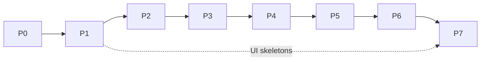

# Motes: roadmap

> Version 2 · 2026-10-29 · source: [DESIGN.md](DESIGN.md)
> This file is the index. Each phase has its own file under [`roadmap/`](roadmap/) with every card in detail.

## How the roadmap is organized

```
Phase (P0…P7)          a usable milestone with a gate
└─ Epic (P0-03)        one area of the system (e.g. the database)
   └─ Card (P0-03-02)  one issue: one focused change, its tests, one PR
```

- **Card id** `Pn-EE-CC` = phase, epic, card. Use it as the issue key and put it in the commit or PR title, e.g. `feat(db): add migration runner (P0-03-02)`.
- **One card = one issue = one agent run.** If a card turns out bigger than one PR, split it into `P0-03-02a`, `P0-03-02b` and note it in the card.
- Cards in one epic usually run in order. Cards in different epics with no shared dependency can run in parallel.
- A phase **gate** is a check the owner runs by hand before the next phase starts.

## Card format

Every card in the phase files follows this shape, so it can be pasted into an issue as is:

```md
### P0-03-02 · Migration runner
**What this is:** what the piece is, in plain words, and where it sits in the system.
**Why:** what breaks or is impossible without it.
**Steps:**
1. ordered implementation steps the builder follows
**Done when:**
- [ ] checkable acceptance criteria (tests, commands, observable behavior)
**Out of scope:** what not to do in this card (it belongs to another card)
**Deps:** cards merged first · **Touches:** packages/apps · **Size:** S (≤ ½ day) / M (≤ 1 day)
```

Implied by every card, not repeated in each one:
- tests for the new behavior, next to the code (DESIGN §8);
- `pnpm check` green (lint, boundaries, typecheck, tests);
- no import that breaks the package boundaries;
- docs updated in the same PR if the card changes a decision in DESIGN.md;
- code, comments and commits in English; UI text in pt-BR.

Tags:
- `UI · visual TBD`: builds a functional skeleton only; the visual design comes in P7 with the owner.
- `Pending owner decision`: the card carries an assumption that the owner still has to confirm (see below).

## Phases

| Phase | File | Delivers | Gate |
|---|---|---|---|
| **P0 · Foundation** | [P0-foundation.md](roadmap/P0-foundation.md) | Monorepo, protocol, database, server, realtime, client packages, desktop shell | CI green; the desktop app connects to the server and shows a live event |
| **P1 · Pipeline** | [P1-pipeline.md](roadmap/P1-pipeline.md) | Projects, cards, board, bots, runtimes, daemon, engines, runs, review, inbox, usage | Owner assigns a card in the app, a Dev bot fixes it on the Mac mini, it lands in review with a PR |
| **P2 · Safety base** | [P2-safety.md](roadmap/P2-safety.md) | Audit, capabilities, rules, approvals, tool gateway, secrets, budgets, kill switch | Every Motes side effect and every dev-run command and push is audited; a budget breach pauses a bot |
| **P3 · Decision layer** | [P3-decision.md](roadmap/P3-decision.md) | Tiered decider, rules, model providers, cheap and frontier tiers, Jev, evals, cost view | Routing runs at the cheapest tier and its cost is visible per bot |
| **P4 · Boss and channels** | [P4-boss-channels.md](roadmap/P4-boss-channels.md) | Office-bot runtime, chat, Boss, Plow iMessage, approval by code, Telegram | Owner texts the Boss on iMessage, a card is created and worked, the Boss reports back |
| **P5 · Autonomous team** | [P5-autonomy.md](roadmap/P5-autonomy.md) | Triggers, scheduler, webhooks, handoffs, memory, skills, digests | Owner goes a full day giving orders only through the Boss |
| **P6 · Support and the Mac** | [P6-support-mac.md](roadmap/P6-support-mac.md) | WhatsApp, third-party policy, Support and Triage bots, Latch integration | The canonical scenario (DESIGN §3) runs end to end without the owner |
| **P7 · Interface and reach** | [P7-interface-reach.md](roadmap/P7-interface-reach.md) | Visual design, web, MacBook Air runtime, notch, mobile, more channels | Defined with the owner at the start of the phase |



## Pending owner decisions

| # | Question | Assumption used until answered | Cards affected |
|---|---|---|---|
| Q1 | Can the Boss merge a PR from a chat message, or does the owner always merge on GitHub? | Merge through Motes requires an approval code (never a plain message); merging on GitHub is always possible and Motes detects it | P1-09-04, P1-09-05, P4-06-04 |
| Q2 | Are Claude Code and Codex paid by subscription or by API key? | Track both: tokens and estimated cost, and the CLI's usage-window or rate-limit signals; budgets support both units | P1-10-01, P1-10-02, P2-06-01 |

## Progress

Mark cards here as they merge (or track them only in the issue tracker and delete this section).

| Phase | Cards | Done |
|---|---|---|
| P0 | 31 | 0 |
| P1 | 56 | 0 |
| P2 | 22 | 0 |
| P3 | 16 | 0 |
| P4 | 31 | 0 |
| P5 | 22 | 0 |
| P6 | 17 | 0 |
| P7 | outline | — |
