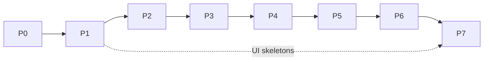

# Motes: roadmap

> Version 1 · 2026-10-29 · source: [DESIGN.md](DESIGN.md)
> Phases → epics → **cards**. Each card is sized for one agent run: one focused change, its tests, one PR.

## How to use the cards

- Card id `Pn-EE-CC` = phase, epic, card (e.g. `P1-03-02`). Use it as the ticket key and in the commit or PR title.
- Each card lists **Deps** (cards that must be merged first), **Touches** (packages or apps) and **Done when** (acceptance criteria a reviewer can check).
- Cards inside one epic usually run in order. Cards in different epics with no shared deps can run in parallel.
- Every card also implies: tests for the new behavior, `pnpm check` green, boundaries respected (DESIGN §8), docs updated if a decision changed.
- `UI · visual TBD` marks cards that only build functional skeletons. The visual design is decided with the owner in phase 7.

## Overview

| Phase | Delivers | Gate (must be true before the next phase) |
|---|---|---|
| **P0 · Foundation** | Monorepo, protocol, database, server, realtime, client packages, desktop shell | `pnpm check` green in CI; desktop app connects to the server and shows a live event |
| **P1 · Pipeline** | Projects, cards, board, comments, runtimes, daemon, dev runs, review, inbox, usage | Owner assigns a card in the app, a Dev bot fixes it on the Mac mini and it lands in review with a PR |
| **P2 · Safety base** | Audit, capabilities, rules, approvals, secrets, budgets, kill switch | Every Motes tool side effect and every dev-run command and push is in the audit log; a budget breach pauses a bot |
| **P3 · Decision layer** | Tiered decider, rule tier, cheap LLM, Jev classifier, decision records, evals | Routing decisions run at the cheapest tier and their cost is visible per bot |
| **P4 · Boss and channels** | Office-bot runtime, Boss, Plow iMessage, approval by code, Telegram | Owner texts the Boss on iMessage, a card gets created and worked, and the Boss reports back |
| **P5 · Autonomous team** | Event bus triggers, handoffs, standing bots, memory, skills, digests | Owner goes a full day giving orders only through the Boss |
| **P6 · Support and the Mac** | WhatsApp adapter, Support and Triage bots, Latch integration | The canonical scenario (DESIGN §3) runs end to end without the owner |
| **P7 · Interface and reach** | Visual design, bots-as-contacts UI, web app, MacBook Air runtime, notch client | Defined with the owner when the phase starts |

---

# P0 · Foundation

## P0-01 · Repository

**P0-01-01 · Monorepo scaffold**
pnpm workspaces + Turborepo, Node 24, strict `tsconfig.base.json`, Biome, Vitest root config, empty `apps/*` and `packages/*` folders from DESIGN §8 with `package.json` each.
Deps: none · Touches: root · Done when: `pnpm install`, `pnpm build`, `pnpm lint`, `pnpm test` all run and pass on an empty workspace.

**P0-01-02 · Boundaries check**
`scripts/check-boundaries.ts` that reads each package's imports and fails on any edge not allowed by DESIGN §8 (e.g. `ui → core`, `views` defining a store, `domain → fastify`).
Deps: P0-01-01 · Touches: scripts · Done when: a fixture with a forbidden import fails the script; `pnpm boundaries` is part of `pnpm lint`.

**P0-01-03 · CI**
GitHub Actions workflow running `pnpm check` (lint, boundaries, typecheck, test) on push and PR, with a Postgres service for later DB tests.
Deps: P0-01-02 · Touches: `.github` · Done when: a PR shows the check and it passes.

**P0-01-04 · AGENTS.md, CLAUDE.md and README**
Builder instructions: reading order (DESIGN, ROADMAP, the card), boundaries, state rules, testing rules, commit convention (conventional commits, English, card id in the title), UI text in pt-BR. `CLAUDE.md` imports `AGENTS.md`.
Deps: P0-01-01 · Touches: root docs · Done when: files exist and match DESIGN §8.

## P0-02 · Protocol (`packages/protocol`)

**P0-02-01 · Ids and base schemas**
Prefixed sortable ids (`card_…`, `run_…`, `bot_…`), timestamps, pagination, error envelope, all as zod schemas with inferred types.
Deps: P0-01-01 · Touches: protocol · Done when: unit tests cover id generation, parsing and rejection of malformed ids.

**P0-02-02 · Event envelope**
Typed event union (`type`, `id`, `occurredAt`, `actor`, `payload`) with a registry that later cards extend. Includes a fallback for unknown event types on clients.
Deps: P0-02-01 · Touches: protocol · Done when: an unknown event parses into the fallback shape without throwing.

**P0-02-03 · Canonical JSON and digest**
Stable JSON serialization and SHA-256 digest helper, used later for capability rule keys and approval binding.
Deps: P0-02-01 · Touches: protocol · Done when: key order and whitespace do not change the digest; tests include nested objects and arrays.

## P0-03 · Database (`packages/db`)

**P0-03-01 · Postgres setup**
`docker-compose.yml` for local Postgres, `DATABASE_URL` config, a test helper that creates an isolated database per test file.
Deps: P0-01-01 · Touches: root, db · Done when: `pnpm db:up` starts Postgres and a sample test connects.

**P0-03-02 · Drizzle and migration runner**
Drizzle setup, SQL migration files, a runner that records applied migrations, and `pnpm db:migrate` / `db:check`.
Deps: P0-03-01 · Touches: db · Done when: running migrations twice is a no-op; `db:check` fails if the schema and migrations drift.

**P0-03-03 · Event outbox table**
`events` table plus a repository that appends an event inside the caller's transaction.
Deps: P0-03-02, P0-02-02 · Touches: db · Done when: an event written in a rolled-back transaction does not exist.

## P0-04 · Server (`apps/server` + `packages/domain`)

**P0-04-01 · Fastify bootstrap and composition root**
Config loading, logger, graceful shutdown, health route, a composition root where domain services get their dependencies injected.
Deps: P0-03-02 · Touches: server, domain · Done when: `GET /health` returns version and DB status; SIGTERM closes cleanly.

**P0-04-02 · Owner auth and device tokens**
Single owner. First run prints a one-time setup code; a client exchanges it for a device token. Tokens are hashed at rest, listable and revocable.
Deps: P0-04-01 · Touches: server, domain, db · Done when: requests without a valid token get 401; revoking a token blocks it immediately.

**P0-04-03 · Realtime WebSocket**
Authenticated WS endpoint that streams events from the outbox to connected clients, with a resume cursor after reconnect.
Deps: P0-04-02, P0-03-03 · Touches: server, domain · Done when: a client reconnecting with a cursor receives exactly the events it missed.

## P0-05 · Client packages

**P0-05-01 · `packages/core`: API client**
Typed fetch client built from protocol schemas, parsing every response with zod and `parseWithFallback`, auth header injection through a `StorageAdapter`.
Deps: P0-04-02 · Touches: core · Done when: a malformed response test returns the fallback instead of crashing.

**P0-05-02 · `packages/core`: Query and realtime wiring**
TanStack Query client factory, a WS client with reconnect and cursor, and an event→cache invalidation registry.
Deps: P0-05-01, P0-04-03 · Touches: core · Done when: a test event invalidates the matching query key.

**P0-05-03 · `packages/ui`: tokens and primitives**
Neutral design tokens (color, type scale, spacing, radius) and base primitives (Button, Input, Dialog, Menu, Toast). `UI · visual TBD`
Deps: P0-01-01 · Touches: ui · Done when: primitives render in a component test; no import from `core`.

**P0-05-04 · `packages/views`: navigation adapter**
`NavigationAdapter` interface, `AppLink`, and a layout shell component that apps provide routing to.
Deps: P0-05-03 · Touches: views · Done when: a test renders the shell with a fake adapter.

## P0-06 · Desktop shell (`apps/desktop`)

**P0-06-01 · Electron shell**
electron-vite app, secure defaults (context isolation, no node integration, strict CSP), a preload exposing only a typed bridge.
Deps: P0-05-04 · Touches: desktop · Done when: the app opens a window rendering the views shell.

**P0-06-02 · Connect to server**
Setup screen: server URL + setup code → device token stored in the Keychain; connection status in the shell; a live event counter proving realtime works. `UI · visual TBD`
Deps: P0-06-01, P0-05-02 · Touches: desktop, views, core · Done when: P0 gate passes.

---

# P1 · Pipeline

## P1-01 · Projects and cards

**P1-01-01 · Projects**
Table, domain service and routes: create, rename, archive, list; repository links (local path per runtime, remote URL); default runtime.
Deps: P0-04-02 · Touches: db, domain, server, protocol · Done when: CRUD tests pass; archived projects are hidden by default.

**P1-01-02 · Cards**
Table and service: title, description (markdown), status, priority, labels, polymorphic assignee (`assignee_type` + `assignee_id`), human-readable number per project. Emits `card.created` / `card.updated` / `card.status_changed`.
Deps: P1-01-01, P0-03-03 · Touches: db, domain, server, protocol · Done when: every mutation emits the right event in the same transaction.

**P1-01-03 · Card ordering and board query**
Position within a status column, move/reorder API, and a board query grouped by status with filters (assignee, label, priority).
Deps: P1-01-02 · Touches: db, domain, server · Done when: concurrent reorders do not produce duplicate positions.

**P1-01-04 · Comments and activity timeline**
Comments (markdown, author owner or bot) and system activity entries (status change, assignment, run started, handoff) in one ordered timeline.
Deps: P1-01-02 · Touches: db, domain, server · Done when: the timeline API returns comments and activity interleaved by time.

**P1-01-05 · Board and card views** `UI · visual TBD`
Board columns with drag to move, card detail with timeline and comment box, project switcher. Live updates via WS invalidation.
Deps: P1-01-03, P1-01-04, P0-06-02 · Touches: views, core, desktop · Done when: two windows stay in sync when a card moves.

## P1-02 · Bots

**P1-02-01 · Bot spec and registry**
Bot table with the spec from DESIGN §6.2 (kind `dev` or `office`, engine, instructions, limits, budget). zod schema in protocol.
Deps: P0-04-02 · Touches: protocol, db, domain, server · Done when: invalid specs are rejected with field-level errors.

**P1-02-02 · `bot.md` import and export**
Front matter + markdown body ↔ bot spec.
Deps: P1-02-01 · Touches: protocol · Done when: round-trip tests keep the spec identical.

**P1-02-03 · Bot list and editor** `UI · visual TBD`
List bots, create and edit a spec, enable or pause.
Deps: P1-02-01, P0-06-02 · Touches: views, core · Done when: editing a bot updates it live in other windows.

## P1-03 · Runtimes and daemon

**P1-03-01 · Runtime registration and heartbeat**
Daemon tokens (minted from the app), runtime table (machine name, engines found, capacity), heartbeat route, online/offline derived from the last heartbeat.
Deps: P0-04-02 · Touches: db, domain, server, protocol · Done when: a runtime missing heartbeats flips to offline and emits an event.

**P1-03-02 · Daemon process**
`apps/daemon`: config, login with a daemon token, heartbeat loop, engine discovery (`claude`, `codex` on PATH with versions), LaunchAgent install command.
Deps: P1-03-01 · Touches: daemon · Done when: the daemon shows as online in the runtimes API and survives a server restart.

**P1-03-03 · Run model and queue**
Run table with the states from DESIGN §6.3, a Postgres-backed claim (`FOR UPDATE SKIP LOCKED`) filtered by runtime and engine, and state transition rules.
Deps: P1-01-02, P1-02-01, P1-03-01 · Touches: db, domain · Done when: two daemons claiming at once never get the same run; illegal transitions are rejected.

**P1-03-04 · Run triggers from the pipeline**
Assigning a card to a dev bot, mentioning a bot in a comment, or messaging a bot in chat queues a run with the right context snapshot.
Deps: P1-03-03, P1-01-04 · Touches: domain · Done when: each trigger creates exactly one run.

**P1-03-05 · Worktree management**
In the daemon: one git worktree per run from the project's repo on that machine, a directory lock (`waiting_directory`), cleanup and garbage collection.
Deps: P1-03-02 · Touches: daemon · Done when: two runs on the same repo get separate worktrees; a crashed run's worktree is collected.

## P1-04 · Engines (`packages/engines`)

**P1-04-01 · Engine driver interface and fake engine**
`EngineDriver` contract (start, stream events, send a follow-up, stop, usage) and a fake engine for tests.
Deps: P1-03-02 · Touches: engines · Done when: the daemon runs a full fake run end to end in tests without any real CLI.

**P1-04-02 · Claude Code driver**
Spawn `claude` in stream-json mode inside the worktree, map its events to the execution log, capture usage and cost.
Deps: P1-04-01 · Touches: engines · Done when: a recorded stream fixture maps to the expected log; a live smoke test exists behind an env flag.

**P1-04-03 · Codex driver**
Drive the Codex app server, same mapping and usage capture.
Deps: P1-04-01 · Touches: engines · Done when: same as P1-04-02 with Codex fixtures.

**P1-04-04 · Steering a running run**
A message sent to a bot while it runs is delivered into the current run when the engine supports it, otherwise queued for the next one.
Deps: P1-04-02, P1-04-03 · Touches: engines, daemon, domain · Done when: tests cover both delivery paths.

## P1-05 · Execution, review and inbox

**P1-05-01 · Execution log ingestion**
Daemon streams log entries (tool call, command, output chunk, error) to the server; stored per run; streamed to clients live.
Deps: P1-04-01, P0-04-03 · Touches: daemon, server, domain, db · Done when: a reconnecting client replays the full log in order.

**P1-05-02 · Run view** `UI · visual TBD`
Run list per card and a run detail with the live log, state, duration, cost.
Deps: P1-05-01, P1-01-05 · Touches: views, core · Done when: the log updates live while a fake run executes.

**P1-05-03 · Review gate and PR**
At run end the daemon pushes a branch and opens a PR (GitHub via `gh` first), attaches the diff summary to the card, and moves it to `in_review`. Never pushes to `main`.
Deps: P1-03-05, P1-05-01 · Touches: daemon, domain · Done when: a test repo run ends with a branch, a PR link on the card and status `in_review`.

**P1-05-04 · Retries, timeouts and stalls**
Configurable retry policy for failed runs, stall detection from inactivity (not wall-clock), and a clear failure reason on the card.
Deps: P1-03-03 · Touches: domain, daemon · Done when: a stalled fake run is marked failed with a reason and retried once.

**P1-05-05 · Inbox**
Inbox items for review requests, failures, questions and (later) approvals and budgets; read/archive.
Deps: P1-05-03 · Touches: db, domain, server, views · Done when: a run in review creates one inbox item and resolving the review closes it.

**P1-05-06 · Usage and cost**
Per-run token and cost records, rollups per bot, card, project and day.
Deps: P1-04-02 · Touches: db, domain, server · Done when: P1 gate passes and the card shows its total cost.

---

# P2 · Safety base

## P2-01 · Audit and capabilities (`packages/security`)

**P2-01-01 · Append-only audit log**
Audit table with no update or delete path in code (and a DB trigger rejecting updates), a writer used by every side-effecting service.
Deps: P0-03-02 · Touches: security, db · Done when: attempts to update an audit row fail; existing side effects from P1 write audit entries.

**P2-01-02 · Capability sets and rule keys**
Capability schema, normalization (sorted, canonical paths, reasons stripped) and rule key = digest of `(bot, capability set)`.
Deps: P0-02-03 · Touches: security, protocol · Done when: equivalent sets produce the same key; any argument difference changes it.

**P2-01-03 · Rules**
Always-allow and always-deny rules keyed on the exact rule key, listable and revocable.
Deps: P2-01-02 · Touches: security, db, server · Done when: a revoked rule stops matching immediately.

## P2-02 · Approvals

**P2-02-01 · Approval service**
Create an approval bound to `(rule key, nonce, args digest, expiry)`, resolve once (allow once, always, deny), expire, emit events, create an inbox item.
Deps: P2-01-03, P1-05-05 · Touches: security, domain · Done when: a second resolution of the same approval fails; expired approvals cannot be resolved.

**P2-02-02 · Tool gateway**
A single gate every Motes tool with side effects goes through: derive the capability set, check rules, require an approval or deny, write audit.
Deps: P2-02-01 · Touches: security, domain · Done when: a tool without a capability declaration cannot be registered.

**P2-02-03 · Approval UI** `UI · visual TBD`
Approval card showing the high-level context and the exact capabilities, with allow once / always / deny; rules manager; audit viewer.
Deps: P2-02-01, P0-06-02 · Touches: views, core · Done when: resolving in the app unblocks a waiting test tool call.

## P2-03 · Secrets, budgets, kill switch

**P2-03-01 · Secret store**
Keychain-backed `SecretStore` with references in the DB; values never serialized into prompts, logs or events.
Deps: P0-04-01 · Touches: security · Done when: a test scanning logs and events after a tool call finds no secret value.

**P2-03-02 · Budgets**
Per-bot daily budget, per-chain budget and a global daily cap, checked before each run and each decision; breach pauses the bot and creates an inbox item.
Deps: P1-05-06 · Touches: domain, security · Done when: P2 gate passes for the budget part.

**P2-03-03 · Kill switch**
One action (app and later channel command) that pauses all bots, cancels running runs and stops channel sends.
Deps: P2-03-02 · Touches: domain, daemon, server · Done when: after the switch no run is running and no message is sent until resumed.

---

# P3 · Decision layer (`packages/decision`)

**P3-01-01 · Decider interface and decision records**
`Decider` per DESIGN §11, decision table (kind, tier, model, cost, confidence, escalation path, latency), budget check before each call.
Deps: P2-03-02 · Touches: decision, db, domain · Done when: every decision call writes exactly one record.

**P3-01-02 · Rule tier**
Registry of deterministic handlers per decision kind; a handler can decide or pass.
Deps: P3-01-01 · Touches: decision · Done when: a decision fully handled by rules makes no network call (asserted in tests).

**P3-01-03 · Model provider abstraction**
Provider interface with Anthropic and OpenAI-compatible implementations (OpenRouter, Ollama, LM Studio), structured output validated against the request's zod schema, retry on invalid output.
Deps: P3-01-01 · Touches: decision · Done when: invalid model output is retried once and then escalates.

**P3-01-04 · Cheap LLM and frontier tiers**
Tier configuration (model per tier), escalation when the result fails validation or confidence is low, `minTier` / `maxTier` from the bot spec.
Deps: P3-01-03 · Touches: decision · Done when: a request with `maxTier: cheap_llm` never reaches the frontier tier.

**P3-01-05 · Jev classifier provider**
Classifier tier backed by Jev: typed choices with confidence, threshold per decision kind, escalation below threshold. Read the vendor docs first and record the endpoints and limits used in `packages/decision/JEV-NOTES.md`.
Deps: P3-01-04 · Touches: decision · Done when: recorded fixtures cover a confident decision and an escalation.

**P3-01-06 · Decision eval harness**
CLI that replays recorded decisions against a different provider or threshold and reports agreement, cost and latency.
Deps: P3-01-05 · Touches: decision, scripts · Done when: a report compares two configurations on a fixture set.

**P3-01-07 · Cost view** `UI · visual TBD`
Cost per bot, per decision kind and per tier, by day.
Deps: P3-01-01, P1-05-06 · Touches: views, core · Done when: P3 gate passes.

---

# P4 · Boss and channels

## P4-01 · Office-bot runtime (`packages/bots`)

**P4-01-01 · Conversations and messages**
Conversation and message tables with origin (app, channel), trust level (`owner`, `bot`, `third_party`) and attachments.
Deps: P1-02-01 · Touches: db, domain, protocol · Done when: a third-party message can never be stored with trust `owner` through any API.

**P4-01-02 · Agent loop**
One turn = build prompt (instructions + memory + conversation + third-party text wrapped as data) → model from the decision layer → tool calls through the tool gateway → reply. Turn limits per spec.
Deps: P4-01-01, P3-01-04, P2-02-02 · Touches: bots · Done when: a scripted fake model drives a multi-tool turn in tests.

**P4-01-03 · Per-bot FIFO queue**
Each office bot processes one turn at a time; pause, resume, cancel; crash-safe persistence.
Deps: P4-01-02 · Touches: bots, db · Done when: killing the server mid-turn resumes the queue without duplicated replies.

**P4-01-04 · Context compaction**
Summarize old conversation segments before the model window fills, keeping the summary linked to the original messages.
Deps: P4-01-02 · Touches: bots · Done when: a long fixture conversation stays under the configured token budget.

**P4-01-05 · Pipeline tools**
Tools for office bots: search cards and runs, create and assign cards, comment, read usage, summarize activity. All through the tool gateway.
Deps: P4-01-02 · Touches: bots, domain · Done when: each tool has a capability declaration and tests.

**P4-01-06 · Chat view** `UI · visual TBD`
Conversation with any bot in the app, with tool calls shown as compact cards.
Deps: P4-01-02, P0-06-02 · Touches: views, core · Done when: chatting with a fake-model bot works in the app.

## P4-02 · The Boss

**P4-02-01 · Boss template and single thread**
Seeded Boss spec, one owner conversation across all channels, replies go to the owner's last channel.
Deps: P4-01-05 · Touches: bots, domain · Done when: messages from two channels land in the same Boss thread.

**P4-02-02 · Report levels**
`now`, `digest` and `silent` classification of events for the owner, decided at the rule or classifier tier.
Deps: P4-02-01, P3-01-02 · Touches: bots, decision · Done when: a run failure is `now` and a routine completion is not, without a frontier call.

**P4-02-03 · `ask_owner`**
A bot can ask the owner a question; the answer goes back to the blocked turn verbatim and never grants permissions.
Deps: P4-02-01 · Touches: bots, domain · Done when: the answer resumes the right turn.

## P4-03 · Channels (`packages/channels`)

**P4-03-01 · Channel contract and registry**
`ChannelAdapter` from DESIGN §12, health reporting, persisted cursors, dedup by external id, per-channel policy (read, reply, rate limit, quiet hours).
Deps: P4-01-01 · Touches: channels, db · Done when: a fake adapter delivering the same message twice creates one message.

**P4-03-02 · Owner identity**
Configured owner handles (E.164 phone, Apple ID email, Telegram user id); `isOwner` computed by adapters with normalized handles.
Deps: P4-03-01 · Touches: channels, server, views · Done when: a lookalike handle (different formatting, same digits elsewhere) is not treated as owner.

**P4-03-03 · Plow iMessage adapter**
Plow Chat API with a line-scoped token from the Keychain, inbound cursor, sending text and attachments, tapbacks as context, health. Write `packages/channels/plow/API-NOTES.md` with the endpoints used before coding.
Deps: P4-03-02, P2-03-01 · Touches: channels · Done when: recorded fixtures cover receive, send, reaction and an outage with backoff.

**P4-03-04 · Approval and question by code**
Short codes per DESIGN §6.4, matched by the adapter before any model sees the message; lockout after five invalid codes in ten minutes; `local_only` approvals sent as notice only.
Deps: P4-03-03, P2-02-01, P4-02-03 · Touches: channels, security · Done when: a valid code from a non-owner handle is rejected and audited.

**P4-03-05 · Telegram adapter**
Official Bot API, long polling, owner chat binding.
Deps: P4-03-02 · Touches: channels · Done when: P4 gate passes on iMessage and Telegram is a working fallback.

---

# P5 · Autonomous team

**P5-01-01 · Triggers**
Trigger table (event type + filter, cron, signed webhook) bound to bots; matches go through the rule tier first.
Deps: P4-01-03, P3-01-02 · Touches: db, domain, bots · Done when: an event matching no rule produces no model call.

**P5-01-02 · Scheduler**
Cron and deferred jobs in the server (`deferred` runs, digests, autopilot-style recurring work), restart-safe.
Deps: P5-01-01 · Touches: domain, server · Done when: a job due during downtime runs once after restart.

**P5-01-03 · Signed webhooks**
Inbound webhook endpoint per trigger with HMAC verification and replay protection.
Deps: P5-01-01 · Touches: server, domain · Done when: a replayed or unsigned request is rejected.

**P5-02-01 · Handoffs and bot messages**
Structured handoff (target, reason, context, card or conversation ref) and free bot-to-bot messages, both in the activity timeline; hop limit and chain budget.
Deps: P5-01-01, P2-03-02 · Touches: domain, bots · Done when: a ping-pong between two bots stops at the hop limit with an inbox item.

**P5-02-02 · Dev runs from office bots**
An office bot can create a card and assign it to a dev bot, chaining office → dev work.
Deps: P5-02-01, P1-03-04 · Touches: bots, domain · Done when: a Triage fake bot's card triggers a fake dev run.

**P5-03-01 · Memory with review**
Per-bot facts with provenance; proposals auto-accepted for low-risk categories, otherwise sent to the inbox.
Deps: P4-01-02 · Touches: bots, db · Done when: a rejected proposal never appears in a prompt.

**P5-03-02 · Skills**
Skill table (markdown + files), attach to bots, injected into office-bot prompts and dev-run worktrees.
Deps: P1-02-01 · Touches: db, domain, daemon, bots · Done when: a dev run's worktree contains the attached skill files.

**P5-03-03 · Boss digests**
Scheduled digests summarizing `digest`-level events per project, sent on the owner's channel.
Deps: P5-01-02, P4-02-02 · Touches: bots · Done when: P5 gate passes.

---

# P6 · Support and the Mac

**P6-01-01 · WhatsApp adapter**
Baileys linked-device pairing by QR in the app, session stored in the Keychain, inbound and outbound text and media, reconnect, health. Conservative default rate limits.
Deps: P4-03-01 · Touches: channels, views · Done when: pairing, receiving and sending work against a test number; a dropped session reports `down`.

**P6-01-02 · Third-party conversation policy**
Which WhatsApp chats a bot may read and answer, per bot; everything else is ignored and logged.
Deps: P6-01-01 · Touches: channels, security · Done when: a message from an unlisted chat never wakes a bot.

**P6-02-01 · Support bot template**
Office bot on a cheap tier answering customers within a knowledge base, classifying messages (bug, question, complaint, other) at the classifier tier, handing bugs to Triage.
Deps: P6-01-02, P5-02-01, P3-01-05 · Touches: bots · Done when: fixture conversations route as expected with no frontier call.

**P6-02-02 · Triage bot template**
Turns a handoff into a well-formed card (title, repro, links to the conversation) in the right project and assigns the Dev bot.
Deps: P6-02-01, P5-02-02 · Touches: bots · Done when: the canonical scenario runs end to end with fake engines.

**P6-03-01 · Latch client through the Plow relay**
MCP client in `packages/security` that office bots use for Mac actions via `PLOW_MCP_URL`; tool results treated as data; every call audited in Motes too.
Deps: P4-01-02, P2-01-01 · Touches: security, bots · Done when: a recorded relay session maps Latch tools into the office-bot tool registry.

**P6-03-02 · Latch-aware tool routing**
Office-bot tools that touch the Mac route only through Latch; Motes' own gateway keeps the tools that do not.
Deps: P6-03-01 · Touches: bots, security · Done when: P6 gate passes with a real Latch install.

---

# P7 · Interface and reach

To be detailed with the owner at the start of the phase. Expected epics:
- **P7-01 · Visual design**: tokens, typography, components; the bots-as-contacts messaging layout next to the board.
- **P7-02 · Web app** from the same views.
- **P7-03 · MacBook Air runtime** over Tailscale, runtime picker per project.
- **P7-04 · Notch client**: `motes-notch` talks to the Motes server (status, approvals, quick replies).
- **P7-05 · Mobile client**.
- **P7-06 · Native iMessage adapter** to remove the Plow dependency.
- **P7-07 · WhatsApp Business API adapter** for higher-volume support.
